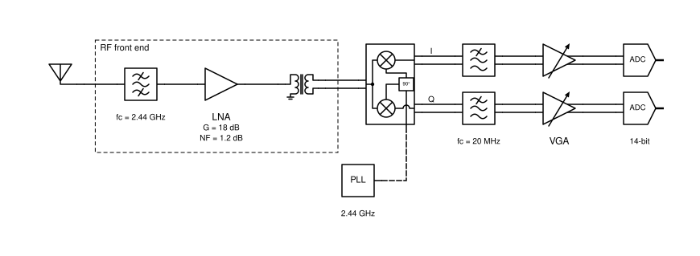

# Lineup

**Signal-aware block diagrams for RF and DSP.** Lineup is a browser-based editor for signal chains: classic RF symbols at a uniform size, differential pairs drawn as real pairs, I/Q paths that split into linked I and Q blocks automatically, and a plain JSON file format that people and AI agents can both write.

It runs entirely client-side. There is no server and no account.



## Features

- **41 core symbols, one per distinct drawing:** amplifier, attenuator, LPF/HPF/BPF/BSF, mixer, I/Q (de)modulator, ×N/÷N, oscillator, crystal, antenna, duplexer, circulator, isolator, switches, coupler, splitter, 90° hybrid, balun, phase shifter, termination, ADC/DAC, Σ, z⁻¹, ↓M/↑L, DDC/DUC, complex multiply, ports, ground, sheets and custom blocks. Adjustable variants add a tuning arrow.
- **Aliases:** write `lna`, `pa`, `vga`, `saw`, `pll`, `vco`, `fir`, `nco`… and Lineup uses the core symbol with that label, so files (and AI agents) can use everyday names.
- **Differential signals:** set a block to differential and its wires become two parallel lines, routed together.
- **Analog, digital and complex domains:** DSP-capable blocks switch between analog, digital (heavy line) and complex (hollow double line, one block instead of an I/Q pair), and mismatched links are flagged.
- **I/Q pairs:** connect a block after an I/Q demodulator and it becomes an I/Q pair, along with everything downstream. Edit the pair as one block, or unlink it.
- **Connection checks:** Lineup flags single-ended ↔ differential mismatches, output-to-output connections, multiple drivers on one input, and bus-width mismatches.
- **Auto-routing and auto-layout:** wires route at right angles on the grid, hopping over the wires they cross. Drag a wire segment to reroute it by hand. Files without coordinates are laid out automatically.
- **Fast editing:** drop a block onto a wire to splice it in, press `/` to add a block by name, or press `Tab` to add the next block in a chain, already connected.
- **Hierarchical sheets:** put a subsystem on its own sheet and place it as one block; its input and output port blocks become the block's ports. Double-click to open, Esc to go back up, or select blocks and choose Make sheet.
- **Cascade analysis:** gain, noise figure, IIP3/OIP3, P1dB, levels and backoff stage by stage, plus kTB, MDS and SNR, along any path (through sheets). Copy the table as CSV or Markdown, or print levels on the wires.
- **Frequency plan:** frequencies carried through mixers, multipliers, ADC aliasing and DDC/DUC shifts, with checks for out-of-passband signals, unfiltered mixer images and ADCs sampling above the first Nyquist zone.
- **Annotations:** wire labels, dashed group boxes and free-text notes.
- **Properties:** gain, NF, IP3, P1dB, frequency, bandwidth, bits and more, stored as numbers in base units. Any property can be shown under its symbol.
- **Consistent text:** diagrams use the bundled Inter font, embedded in SVG, PNG and PDF exports, so they look the same on every machine.
- **Black-and-white output:** line style carries meaning (dashed for LO, dotted for control, heavy for digital buses), so diagrams print well. A color theme is available for slides.
- **Export:** SVG, vector PDF, PNG (2×/4×), copy as image. SVG and PNG exports embed the diagram source (like draw.io), so an image pasted into an issue or doc can be reopened in Lineup, or read exactly by a script or AI agent.

## Quick start

```sh
npm install
npm run dev        # http://localhost:5173
npm test           # unit tests
npm run build      # static site in dist/
```

## Using it

| Action | How |
| --- | --- |
| Add a block | Click it in the palette, drag it onto the canvas, or press `/` and type |
| Add the next block in a chain | Select a block, press `Tab`, type, `Enter` |
| Insert into a wire | Drop a block (or drag an unconnected one) onto the wire |
| Connect | Drag from a port (hover a block to see its ports) to another port |
| Move | Drag blocks; positions snap to the grid |
| Reroute a wire | Drag one of its segments; double-click the wire to reset |
| Group / note | `G` with blocks selected / `N` at the pointer |
| Copy / paste / duplicate | `Ctrl+C` / `Ctrl+V` / `Ctrl+D` |
| Pan / zoom | Space + drag or middle-drag; mouse wheel |
| Rotate / flip | `R` / `F` |
| Auto-layout | `L` (applies to the selection only when 2+ blocks are selected) |
| Fit to view | `0` |
| Undo / redo | `Ctrl+Z` / `Ctrl+Shift+Z` |
| Open a file | Open, drag a `.sig.json` (or an SVG/PNG exported from Lineup) onto the window, or paste JSON with `Ctrl+V` |

Your work is autosaved in the browser.

## File format

```json
{
  "lineup": "0.1",
  "blocks": [
    {"id": "lna", "type": "lna", "params": {"gain": 18, "nf": 1.2}, "show": ["gain"]},
    {"id": "dmd", "type": "iq_demod"},
    {"id": "lpf", "type": "lpf"}
  ],
  "connections": [
    {"from": "lna.out", "to": "dmd.rf"},
    {"from": "dmd.i", "to": "lpf.in"},
    {"from": "dmd.q", "to": "lpf.in"}
  ]
}
```

Coordinates are optional, so a topology-only file like this one is valid; Lineup places the blocks. For the full format see [docs/FORMAT.md](docs/FORMAT.md), and for every block type and port name see [docs/SYMBOLS.md](docs/SYMBOLS.md). The JSON Schema is in [schema/lineup.schema.json](schema/lineup.schema.json).

## Use with AI agents

[`skills/sig-diagrams`](skills/sig-diagrams) is an agent skill that teaches Claude Code, Gemini CLI and similar agents to create, edit, check and explain `.sig.json` diagrams. It includes `check.py` (the same connection checks as the app) and `extract.py` (pulls the diagram out of an exported SVG/PNG). Download it from the **AI agents** button in the app, or copy the folder into your project's `.claude/skills/`.

## Project layout

```
src/model/    types, symbol registry, expansion (I/Q, diff), rules, I/Q helpers, serialisation
src/render/   wire router, theme, SVG diagram components
src/editor/   editor state (undo/redo) and the canvas
src/layout/   ELK auto-layout
src/io/       schema validation, autosave, file and export helpers
src/ui/       palette and properties panel
symbols/      one JSON file per symbol
schema/       JSON Schema for .sig.json
docs/         format and symbol reference
skills/       agent skill (sig-diagrams) for Claude Code, Gemini CLI, …
examples/     sample diagrams
```

## Contributing

New symbols are the easiest way to help. See [CONTRIBUTING.md](CONTRIBUTING.md).

## License

MIT. Lineup bundles the [Inter](https://rsms.me/inter) typeface (SIL Open Font License 1.1, see `src/assets/fonts/OFL.txt`), which is embedded in exported files.
